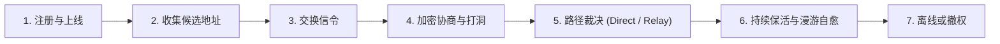

# 连接生命周期

本篇文档系统性介绍 P2WLAN 节点从上线、发现对端、建立直连或中继，到故障自愈与断开的完整连接生命周期。

---

## 1. 生命周期全景阶段

节点间建立虚拟网络互通的过程分为以下几个标准阶段：

1. **注册与上线**：客户端启动后连接 Control 服务器，完成身份验证，拉取所属网络/房间的对端列表；
2. **收集候选地址**：客户端通过 STUN 服务探测本机局域网 IP、公网映射端口及 NAT 类型模型；
3. **交换信令**：双方通过 Control 提供的 WebSocket 信令通道安全交换各自的候选地址与打洞方案；
4. **加密协商与打洞**：节点间基于 Noise 协议发起端到端密钥交换，并同步执行并发 UDP 探测与打洞；
5. **路径裁决（Direct / Relay）**：评估打洞结果，优先选定延迟最低的 Direct 直连路径，若直连受阻则无缝走 Relay 中继；
6. **持续保活与漫游自愈**：定期发送心跳包探测对端状态；当设备网络发生切换（如从 Wi-Fi 切换至蜂窝数据）时，自动触发重测并平滑迁移链路；
7. **离线或撤权**：用户主动退出房间或租约到期时，安全销毁会话与路由。

---

## 2. Direct-first 智能选路机制

为了在任何复杂网络下都能兼顾“最低延迟”与“极高连接可用性”，P2WLAN 实现了 Direct-first 动态选路算法：

- **直连优先窗口**：在节点首次在线的几秒内，客户端会全力发起局域网探测、IPv6 连通以及 IPv4 UDP 打洞探测；
- **中继后台预热**：与此同时，客户端会在后台提前与 Relay 中继建立安全连接并完成票据鉴权作为后备通道；
- **平滑体验保障**：
  - 若 P2P 直连打洞成功，业务流量立刻走直连通道，中继通道作为静默热备；
  - 若在限定窗口内直连未能建立（例如双方均位于严苛的对称型企业防火墙后），业务流量自动无感切入 Relay 转发，绝不让用户长时间卡顿等待；
  - 在后续通信期间，若网络状况好转（例如探测到了可用的 IPv6 地址），链路会自动升级为直连通道。

---

## 3. 网络切换与漫游自愈

移动设备或笔记本电脑在移动办公场景下经常面临网络环境切换（如断开 Wi-Fi 连上 4G/5G）：

- **操作系统事件监听**：客户端通过系统原生网络回调（Android NetworkCallback、macOS/Windows 网络变更事件）实时捕获物理网卡变化；
- **快速重连与套接字重建**：一旦检测到本地网关或出口 IP 变更，底层网络核心会立即重置旧套接字，发起新一轮轻量 STUN 探测；
- **无缝重协商**：通过新网络通知对端重新协商候选端口，最大程度缩短切网造成的连接中断时间。
